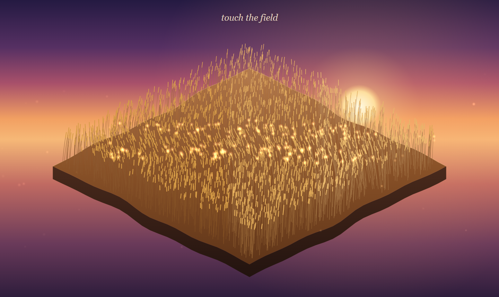

# Dormito



A small square patch of golden wheat, seen as a diamond floating in a sunset sky. Brush a hand through the wheat and the stalks ring with soft little
chimes; each brush sends a wave rolling out through the field, and every so often a gust sweeps the
whole meadow at once.

Vite + TypeScript, Canvas 2D, Web Audio. No samples: every sound is synthesized.

```
npm install
npm run dev        # http://127.0.0.1:5810/
npm run build      # dist/, works from any folder (relative paths)
npm run tune       # the simulation without a browser: idle, slow brush, fast swipe, gust
```

`D` opens the debug panel. URL options: `?seed=N` (same seed, same field and gust timetable),
`?debug` (panel open), `?demo` or `?demo=SECONDS` (a gust and a swipe with no hand).

## How it works

- **Field** (`src/field.ts`): a 110×110 wind-pressure grid over the square patch running a damped 2D wave equation at a
  fixed 120 Hz, with an absorbing rim. The hand lays energy along its path; how much per cell
  depends on speed, so a slow drag ripples and a fast swipe makes a wave without flooding the field.
- **Gusts** (`src/gusts.ts`): every 20–45 s (from the seed), a bowed wind front crosses from one side
  over 4–6 s, building, cresting and fading.
- **Stalks** (`src/stalks.ts`): 2600 damped springs (2000 on phones) spread evenly over the patch, driven by
  the field under them, with a slow breeze that never rings anything.
- **Chimes** (`src/chimes.ts`, `src/scale.ts`): a stalk rings when its bend rises through the
  threshold, at most once per 0.4 s. x (left corner to right corner) walks up two octaves of the scale; the near half of the
  patch is an octave higher, louder and brighter, the far half softer, duller and wetter. Chimes on the
  same pitch within 30 ms merge into one slightly louder chime; at most 6 new ones start per frame.
- **Sound** (`src/audio.ts`): each chime is a sine plus partials at 2.76 and 5.40, with a 2–5 ms
  attack and a 0.6–1.5 s decay (higher notes shorter), ±3 cents detune, a lowpass and a pan from x.
  A 48-voice cap steals the quietest voice. A pink-noise wind bed follows the field's energy. The
  chain is a generated 3.5 s reverb, a gentle compressor, a limiter and a soft clip that tops out
  below full scale, so the output cannot clip.
- **Drawing** (`src/render.ts`): one path per depth slice and light, so thousands of stalks cost a few
  dozen strokes. If a frame takes too long, the field thins itself and fills back later.

## Defaults

| | |
|---|---|
| wave speed c | 0.42 cells per step |
| damping | 0.989 per step |
| brush strength | 1 |
| stalk response | 0.35 rad per unit of field |
| chime threshold | 0.20 rad |
| cooldown | 0.4 s |
| gusts | every 32 s on average (20–45), strength 1 |
| reverb mix | 0.45 |
| volume | 0.8 |
| scale | D major pentatonic |

MIT licence.
